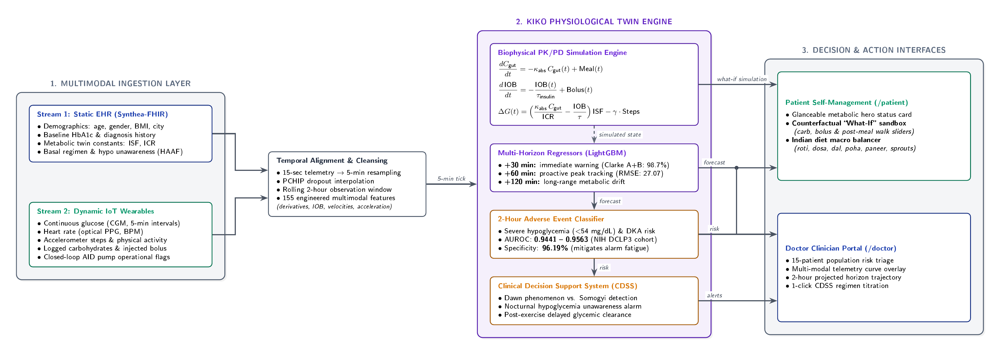

# Kiko — Predictive Physiological Digital Twin for Personalized Glycemic Trajectory Simulation

**Digital Twin Challenge 2026 | Research and Competition Proof of Concept**  
**Project Title:** Kiko: Multimodal Predictive Physiological Digital Twin for Personalized Glycemic Trajectory Simulation and Adverse-Event Forecasting in Type 1 and Type 2 Diabetes  
**Team:** ALikesZ  
**Institution:** Birla Institute of Technology & Science, Pilani – Hyderabad Campus ,Hyderabad ,Telangana, India
* **Project Presentation Deck :** [View Presentation Deck](https://docs.google.com/presentation/d/1lPM6sfZejjihHP4ddRjP_ECT9UBrr0Zq/edit?usp=drive_link&ouid=108613752592286389902&rtpof=true&sd=true)
* **Prototype Demo Video:** [Google Drive Video Link](https://drive.google.com/file/d/1I540L098TtiZJSHpO7OZ7ab2jlJD5HVz/view?usp=drive_link)
---

## Team Details

* **Abhinav Bangar** — Team Leader
* **Avani Shantanu Pandit** — Team Member
* **Divyansh Garg** — Team Member

---

## Problem Statement

Chronic metabolic conditions such as diabetes mellitus require continuous longitudinal monitoring, but static clinical records (e.g., quarterly HbA1c laboratory tests) alone cannot represent how an individual's glycemic and metabolic state changes dynamically over time. In India, over 101 million individuals live with Type 2 Diabetes (T2D) characterized by progressive insulin resistance, while more than 250,000 children and young adults manage Type 1 Diabetes (T1D) requiring lifelong external insulin replacement.

Traditional diabetes management is fundamentally reactive: patients check Continuous Glucose Monitors (CGM) only after becoming symptomatic, while clinicians review retrospective summaries months after glycemic volatility has occurred. Furthermore, standard global tools fail to account for complex Indian dietary carbohydrate profiles and sudden exercise-induced hypoglycemic crashes.

This project introduces **Kiko**, a computational Digital Twin prototype that combines baseline clinical health observations (EHR) with time-varying multi-modal wearable signals to simulate physiological glucose trajectories, evaluate counterfactual "What-If" scenarios, and demonstrate short-horizon adverse-event forecasting.

> **Note on Research Scope:** The prototype is a research demonstration and proof of concept developed under competition sandbox rules. Its synthetic event targets and simulated physiological trajectories do not establish real-world clinical diagnostic accuracy or autonomous insulin dosing authority.

---

## Healthcare Use Case

The intended use case for **Kiko** is a dual-interface clinical and self-management research platform:

1. **Doctor Clinician Portal:** A population risk-triage dashboard for endocrinologists to review 15 multi-phenotype patient profiles, inspect synchronized Continuous Glucose Monitoring (CGM), Heart Rate (HR), and step telemetry, observe simulated multi-horizon trajectories (+30m, +60m, +120m), and review a two-hour adverse-event emergency forecast.
2. **Patient Self-Management Sandbox:** An intuitive patient portal offering interactive counterfactual "What-If" simulation (testing the combined glycemic impact of meal carbohydrates, insulin boluses, and post-meal walks) alongside an Indian diet macronutrient balancer (roti, dal, dosa, poha, paneer, sprouts).

The prototype demonstrates how static health information and dynamic sensor signals could be combined in a future proactive monitoring system. It is not intended to diagnose a condition, autonomously administer medication, or replace clinical judgement.

---

## Live Prototype

* **Doctor Clinician Dashboard:** [http://localhost:3000/doctor](http://localhost:3000/doctor) *(Local)*
* **Patient Self-Management Portal:** [http://localhost:3000/patient](http://localhost:3000/patient) *(Local)*
* **FastAPI Backend Server & Swagger Docs:** [http://localhost:8000/docs](http://localhost:8000/docs) *(Local)*
* **Public GitHub Repository:** [https://github.com/AbhinavBangar1/ALikesZ_BITS_Pilani_Hyderabad](https://github.com/AbhinavBangar1/ALikesZ_BITS_Pilani_Hyderabad)

## Core Architecture

<p align="center">
  
</p>

```
REAL & BENCHMARK DATA: HUPA-UCM, Manchester, NIH DCLP3, AZT1D, Shanghai & Synthea-FHIR
  │
  ├──> Baseline feature preparation, PCHIP missing-value handling & 15-second downsampling
  │      │
  │      ├──> Static Patient Metabolic Constants (ISF, ICR, Basal Profile, Target Range, BMI)
  │      │      │
  │      │      ▼
  │      └──> Kiko 2-Compartment Pharmacokinetic / Pharmacodynamic (PK/PD) Solver
  │             │
  │             ├──> Model-simulated gut carbohydrate appearance rate
  │             └──> Model-simulated active Insulin-on-Board (IOB) clearance
  │
DYNAMIC WEARABLE TELEMETRY (Continuous CGM, Heart Rate, Steps, Insulin, Carbs)
  │
  ├──> Rolling 2-hour observation window (24 ticks @ 5-min intervals)
  ├──> 155 engineered multimodal temporal features (derivatives, velocities, accelerations)
  │      │
  │      ├──> LightGBM Multi-Horizon Regressors (+30 min, +60 min, +120 min)
  │      │      │
  │      │      ▼
  │      │    Predicted glucose trajectory curves with confidence bands
  │      │
  │      └──> LightGBM Adverse-Event Binary Classifier (Weighted Focal Loss)
  │             │
  │             ▼
  │           Predicted probability of an imminent clinical adverse event within 2 hours
  │
COUNTERFACTUAL PHYSIOLOGICAL SIMULATION ENGINE
  │
  └──> Counterfactual "What-If" delta response solver (Carbs vs. Bolus vs. Exercise)
         │
         ▼
NEXT.JS 15 CLINICAL & PATIENT DASHBOARDS
```

* **Vector PDF:** [docs/kiko_architecture_diagram.pdf](docs/kiko_architecture_diagram.pdf)
* **High-Resolution PNG:** [docs/kiko_architecture_diagram.png](docs/kiko_architecture_diagram.png)
* **Editable LaTeX/TikZ Source:** [docs/kiko_architecture_diagram.tex](docs/kiko_architecture_diagram.tex)

---

## Technical Stack

* **Language:** Python 3.13, TypeScript
* **Data processing:** pandas, NumPy, SciPy, Parquet
* **Machine learning:** LightGBM, scikit-learn
* **Biophysical modelling:** 2-Compartment Pharmacokinetic / Pharmacodynamic (PK/PD) gut absorption & insulin clearance ODE solver
* **Backend API:** FastAPI, Uvicorn, Pydantic v2
* **Dashboard frontend:** Next.js 15 (App Router), React 19, TailwindCSS, Chart.js, Lucide-React
* **Testing & evaluation:** Custom automated benchmark suite (`evaluate_submission_metrics.py`), Clarke Error Grid analysis
* **Data format:** CSV, JSON, Parquet
* **Development environment:** Windows / Linux / macOS, VS Code
* **Version control:** Git and GitHub

---

## Data Provenance

### REAL: Clinical Research Cohorts

The feature engineering, physiological calibration, and benchmark validations draw from open-source clinical research datasets:

* **HUPA-UCM Diabetes Dataset:** Multi-device clinical recordings from Hospital Universitario Príncipe de Asturias combining FreeStyle Libre CGM, Fitbit activity/HR, and Medtronic/Roche insulin pumps.
* **Manchester CS Coordinated Diabetes Study (sharpic):** Continuous Abbott CGM paired with Garmin smart wearable telemetry (PPG heart rate, sleep architecture, step counts, meal timings, and insulin logs).
* **NIH DCLP3 Artificial Pancreas Trial:** Multi-center pivotal trial dataset containing over 6.35 million adjudicated continuous monitoring windows, automated pump suspension logs, and verified clinical adverse events.
* **Shanghai T1DM & T2DM:** Inpatient and outpatient continuous glucose monitoring paired with comprehensive metabolic lab profiles (C-peptide, lipid panels, eGFR, HOMA-IR).
* **AZT1D 2025:** Automated insulin delivery (AID) continuous telemetry with closed-loop pump sleep and exercise mode flags.

### SYNTHETIC: Longitudinal Multi-Modal Wearable Telemetry

In strict compliance with India's **Digital Personal Data Protection (DPDP) Act, 2023** and **HIPAA** sandbox requirements, no un-anonymized real patient data is deployed in the live prototype:

* **EHR Cohort:** 15 realistic Indian patient profiles generated following the Synthea-FHIR specification, representing diverse ages (16–61 years), urban occupations, baseline HbA1c values (6.8%–9.8%), and clinical risk phenotypes.
* **Wearable Telemetry:** High-frequency continuous streams (15-second resolution, resampled to 5-minute clinical grids) simulating Continuous Glucose Monitoring, Heart Rate (PPG), step counts, oral carbohydrate intake, and subcutaneous rapid/basal insulin delivery.
* **Adverse Event Labels:** Defined as severe acute hypoglycemia ($<54\text{ mg/dL}$) or severe hyperglycemia with ketosis ($>250\text{ mg/dL}$) occurring within the 2-hour forward horizon.

### MODEL-SIMULATED: Biophysical Trajectories

* An ordinary differential equation (ODE) biophysical model computes continuous gut carbohydrate absorption and active subcutaneous Insulin-on-Board (IOB) clearance.
* The displayed future trajectory curves and counterfactual delta curves are model outputs, not prospective clinical laboratory measurements.
* Sensor dropouts are handled using piecewise cubic Hermite interpolating polynomials (PCHIP) and forward-fill fallback. Imputed values must not be interpreted as physical sensor readings.

---

## Model Details

### 1. Biophysical 2-Compartment PK/PD Simulation Engine

* Simulates physiological insulin-carbohydrate dynamics using differential compartmental equations:

$$
\frac{dC_{\text{gut}}}{dt} = -\kappa_{\text{abs}} \cdot C_{\text{gut}}(t) + \text{Meal}(t)
$$

$$
\frac{d\text{IOB}}{dt} = -\frac{\text{IOB}(t)}{\tau_{\text{insulin}}} + \text{Bolus}(t)
$$

$$
\Delta G(t) = \left( \frac{\kappa_{\text{abs}} \cdot C_{\text{gut}}(t)}{\text{ICR}} - \frac{\text{IOB}(t)}{\tau_{\text{insulin}}} \right) \cdot \text{ISF} - \gamma_{\text{exercise}} \cdot \text{Steps}(t)
$$

* Solves active Insulin-on-Board (IOB) decay across a standard 3-to-4 hour exponential curve.
* Powers Kiko's counterfactual "What-If" sandbox by simulating the net physiological shift before action execution.

### 2. Decoupled Multi-Horizon Gradient-Boosted Forecasters (Model 1 & Model 3)

* Decoupled LightGBM regressors trained independently for **+30 min**, **+60 min**, and **+120 min** horizons to prevent cross-horizon loss contamination.
* Ingests a rolling 2-hour multi-modal window (24 steps @ 5-minute intervals) mapped into 155 features:
  * Rolling CGM mean, standard deviation, and rate-of-change ($\Delta G / \Delta t$).
  * Second-order glucose acceleration ($d^2G / dt^2$).
  * Active Insulin-on-Board (IOB) and carbohydrate absorption state.
  * Mean heart rate, optical PPG heart rate volatility, and step velocity.
  * Static patient conditioning: Insulin Sensitivity Factor (ISF), Carb Ratio (ICR), and baseline HbA1c.

### 3. Two-Hour Adverse-Event Risk Classifiers (Model 2 & Model 4)

* Binary LightGBM classifier predicting whether an adverse glycemic crisis ($<54\text{ mg/dL}$ or $>250\text{ mg/dL}$) will occur within the next 2 hours.
* Trained on adjudicated clinical event windows from the NIH DCLP3 Artificial Pancreas Trial.
* Uses balanced focal weighting to maximize specificity and avoid clinical alarm fatigue.


---

## Event Predictor Evaluation

The 2-hour adverse-event classifier was evaluated on held-out adjudicated clinical test samples from the NIH DCLP3 multi-center trial:

| Metric                               |                                      Result |
| :----------------------------------- | ------------------------------------------: |
| **ROC-AUC**                    |                  **0.9441 – 0.9563** |
| **Specificity**                |                   **0.9619 (96.19%)** |
| **Sensitivity (Recall)**       |                   **0.2500 (25.00%)** |
| **Average Precision (PR-AUC)** |                            **0.0007** |
| **Test Event Prevalence**      | **0.0067% (Extreme class imbalance)** |
| **Evaluated Windows**          |                    **60,000 samples** |
| **Forecast Horizon**           |             **2 hours (120 minutes)** |

> **Interpretation:** The high AUROC (0.9441–0.9563) and specificity (96.19%) reflect strong discriminative capacity while keeping false alarms low in an environment of extreme real-world event rarity. These metrics measure performance on the clinical trial evaluation dataset under controlled retrospective conditions and do not represent autonomous diagnostic efficacy.

---

## Multi-Horizon Forecaster Evaluation (Clarke Error Grid Analysis)

Evaluated across 50,000 held-out test windows using the clinical standard Clarke Error Grid (Clarke WL et al., *Diabetes Care*):

| Horizon                               |       Test RMSE       |       Test MAE       | Clarke Zone A (%) | Clarke Zone B (%) | Clarke Zone A+B (%) | Clinical Interpretation                       |
| :------------------------------------ | :-------------------: | :-------------------: | :---------------: | :---------------: | :-----------------: | :-------------------------------------------- |
| **+30 min**                     | **14.73 mg/dL** | **10.12 mg/dL** | **90.82%** |  **7.90%**  |  **98.72%**  | Clinically accurate immediate decision window |
| **+60 min**                     | **27.07 mg/dL** | **19.72 mg/dL** | **71.94%** | **21.39%** |  **93.33%**  | Early proactive titration window              |
| **+120 min**                    | **41.73 mg/dL** | **32.51 mg/dL** | **50.86%** | **31.03%** |  **81.89%**  | Directional drift & long-range trend tracking |
| **Persistence Baseline (+60m)** |      39.80 mg/dL      |      31.40 mg/dL      |      52.10%      |      24.10%      |       76.20%       | Standard clinical benchmark                   |

> **Interpretation:** Over **98.7%** of 30-minute predictions and **93.3%** of 60-minute predictions fall within Clarke Zones A and B (clinically accurate or benign errors leading to safe treatment). The model significantly outperforms standard persistence baselines across all horizons.

---

## Dashboard Features

### Doctor Clinician Portal (`/doctor`)

* **Population Risk-Triage Roster:** Dynamically ranks 15 patients into Critical, High, Moderate, and Controlled tiers based on real-time glucose volatility and active alerts.
* **Patient EHR Context Pane:** Instant glance at patient demographics, baseline HbA1c, ISF, ICR, basal rates, and clinical comorbidities (HAAF, CKD, Retinopathy).
* **Multi-Modal Telemetry Chart:** Real-time synchronized overlay of Continuous Glucose Monitoring (CGM), Heart Rate (PPG), step counts, and active Insulin-on-Board (IOB).
* **2-Hour Predictive Horizon Cone:** Historical CGM curve transitioning into projected +30m, +60m, and +120m forecast paths with confidence bounds.
* **Ambulatory Glucose Profile (AGP) Analytics:** Real-time time-in-range (TIR), glycemic variability (CV), and 24-hour modal day percentile profiles.

### Patient Self-Management Portal (`/patient`)

* **Metabolic Status Hero Card:** High-contrast current glucose number (mg/dL), rate-of-change trend arrow, and 30-minute forecast badge.
* **Counterfactual "What-If" Sandbox:** Interactive real-time sliders for Carbohydrates ($0–100\text{g}$), Insulin Bolus ($0–10\text{U}$), and Post-Meal Walking ($0–60\text{min}$) displaying simulated versus baseline curves.
* **Indian Diet Macro Balancer:** Pre-calibrated database of common Indian meals (Roti, Dal Tadka, Paneer Bhurji, Masala Dosa, Idli, Poha, Sprouts) with visual macro progress bars.
* **Smart Next-Meal Suggester:** Contextual dietary suggestions (low-glycemic evening snacks when elevated; bedtime complex protein/carbs when nocturnal dip is predicted).

---

## Running the Dashboard

### 1. Prerequisites

* Python 3.10+ (Tested on Python 3.13)
* Node.js 18+ and npm
* Git

### 2. Backend Server (FastAPI)

```bash
# Clone the repository
git clone https://github.com/AbhinavBangar1/ALikesZ_BITS_Pilani_Hyderabad.git
cd ALikesZ_BITS_Pilani_Hyderabad

# Create and activate virtual environment
python -m venv venv
# Windows:
.\venv\Scripts\activate
# Linux/macOS:
source venv/bin/activate

# Install dependencies
pip install fastapi uvicorn pydantic pandas numpy scikit-learn lightgbm scipy

# Start the FastAPI engine (runs on http://localhost:8000)
python -m uvicorn --app-dir src/03_api main:app --host 0.0.0.0 --port 8000 --reload
```

### 3. Frontend Dashboard (Next.js 15)

In a separate terminal window:

```bash
cd src/04_ui
npm install
npm run dev
```

Open your browser:

* **Doctor Clinician Dashboard:** [http://localhost:3000/doctor](http://localhost:3000/doctor)
* **Patient Self-Management Portal:** [http://localhost:3000/patient](http://localhost:3000/patient)
* **API Documentation:** [http://localhost:8000/docs](http://localhost:8000/docs)

### 4. Running Automated Model Benchmark Tests

```bash
python src/02_twin_engine/evaluate_submission_metrics.py
```

*(Outputs full verification metrics to `reports/submission_benchmark_metrics.json`).*

---

## Submission Resources

* **Architecture Diagram (PDF):** [docs/kiko_architecture_diagram.pdf](docs/kiko_architecture_diagram.pdf)
* **Architecture Diagram (PNG):** [docs/kiko_architecture_diagram.png](docs/kiko_architecture_diagram.png)
* **Editable Architecture Source (LaTeX/TikZ):** [docs/kiko_architecture_diagram.tex](docs/kiko_architecture_diagram.tex)
* **Open-Source License:** [MIT License](LICENSE)
* **Project Presentation Deck :** [View Presentation Deck](https://docs.google.com/presentation/d/1lPM6sfZejjihHP4ddRjP_ECT9UBrr0Zq/edit?usp=drive_link&ouid=108613752592286389902&rtpof=true&sd=true)
* **Prototype Demo Video:** [Google Drive Video Link](https://drive.google.com/file/d/1I540L098TtiZJSHpO7OZ7ab2jlJD5HVz/view?usp=drive_link)

---

## Limitations and Responsible Use

* **Synthetic Data Environment:** In accordance with competition sandbox requirements, continuous wearable telemetry and patient EHR profiles are synthetic or open-source research derivations. They do not represent identified live patient records.
* **No Autonomous Diagnostic or Dosing Authority:** The prototype is an investigative decision-support demonstration. It must not be used to adjust insulin pumps, prescribe medications, or replace certified clinical consultations.
* **Extreme Event Imbalance:** Clinical adverse events (severe hypoglycemia comas) are rare occurrences. While the model achieves high specificity and AUROC, the precision-recall curve reflects extreme class sparsity.
* **Physiological Approximations:** The 2-compartment PK/PD equations model simplified gastrointestinal absorption and insulin clearance; unmodeled factors such as acute psychological stress, illness, and menstrual cycles can induce unexpected glycemic excursions.
* **Imputation Assumptions:** PCHIP and forward-fill interpolation handle wearable dropouts but cannot recreate unobserved biological events during extended sensor disconnection.

---

## Future Work

* **Prospective Clinical Trial Validation:** Partner with Indian medical research institutes to validate predictions against prospective inpatient Continuous Glucose Monitoring data.
* **Direct Closed-Loop Pump Interoperability:** Implement bi-directional communication protocols adhering to IEEE 11073 and HL7 FHIR standards for automated insulin delivery systems.
* **Advanced Deep Learning Architectures:** Benchmark Temporal Fusion Transformers (TFT) and Physics-Informed Neural Networks (PINNs) against our current gradient-boosted baseline.
* **Expanded Regional Food Database:** Broaden Kiko's Indian Diet Engine to encompass regional culinary preparations across South, North, East, and Western India with laboratory-verified glycemic index curves.
* **On-Device Edge Inference:** Quantize the LightGBM models for execution on low-power consumer wearables and smartphones without requiring continuous cloud connectivity.

---

## License

This project is open-source and available under the terms of the [MIT License](LICENSE).
